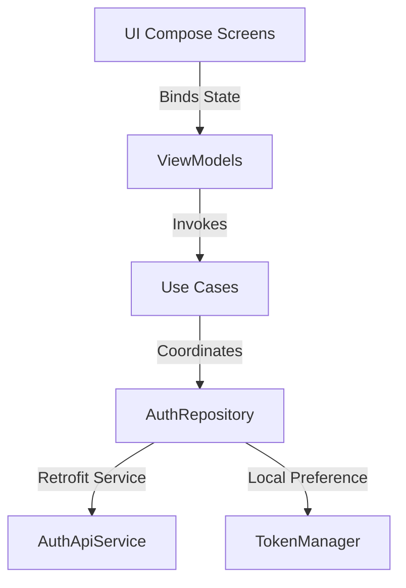

# Milestone 2: Authentication & Session Management Complete

This milestone establishes a secure, token-based authentication system with refresh token rotation and multi-device session mapping. Both the Spring Boot backend REST endpoints and the Android Jetpack Compose client architecture are fully integrated and compile successfully.

---

## 1. Backend Authentication Architecture

### 1.1 Endpoints Exposed (`AuthController.java`)
Exposed at `http://localhost:8080/api/v1/auth/`:

| Method | Endpoint | Description | Permitted Publicly |
| :--- | :--- | :--- | :--- |
| **POST** | `/register` | Validates credentials, inserts User/Profile/Settings, issues JWTs | Yes |
| **POST** | `/login` | Verifies password hash, binds device ID, rotates session | Yes |
| **POST** | `/refresh-token` | Invalidate current JWT/Refresh Token, issue rotated tokens | Yes |
| **POST** | `/validate-token` | Verifies token validation & active status in DB | Yes |
| **POST** | `/logout` | Invalidates active token, updates device status to inactive | No (Requires JWT) |

### 1.2 Security & Session Features
- **BCrypt Hashing**: Passwords stored using BCrypt (12 rounds) inside the database.
- **Refresh Token Rotation**: Once a refresh token is used, the session updates to a new refresh token. Reusing an old refresh token throws `400 Bad Request` with `"Active session not found for refresh token"`.
- **Global Error Handling**: Uncaught/validation exceptions mapped to standard JSON response:
  ```json
  {
    "statusCode": 400,
    "message": "Username is already taken",
    "error": "Bad Request",
    "timestamp": "2026-07-14T09:06:27.926835",
    "path": "/api/v1/auth/register"
  }
  ```

---

## 2. Android Client Integration

The Android client matches the domain-driven multi-layer design pattern:



### 2.1 Domain & Data Layers
- **DTOs (`data/model/`)**: Request (`LoginRequest`, `RegisterRequest`) and response (`AuthResponse`, `UserResponse`) data classes.
- **Service (`data/datasource/remote/AuthApiService.kt`)**: Retrofit implementation of registration, login, logout, validate, and refresh endpoints.
- **Local Cache (`util/TokenManager.kt`)**: Encapsulates access tokens, refresh tokens, and userId using reactive Jetpack DataStore Preferences (`Flow<String?>`).
- **Repository (`AuthRepositoryImpl.kt`)**: Binds Retrofit calls to the DataStore cache.

### 2.2 Presentation & ViewModels (`presentation/screen/auth/`)
- **LoginViewModel / RegisterViewModel**: Exposes Compose states (`AuthUiState: Idle, Loading, Success, Error`) and triggers business Use Cases.
- **Jetpack Compose Screens (`LoginScreen`, `RegisterScreen`)**:
  - Bound to Hilt ViewModels (`hiltViewModel()`).
  - Implements client-side validations (matching passwords, non-empty fields).
  - Displays polished loading spinners and error container banners.

### 2.3 Dependency Injection (`di/`)
- **`NetworkModule.kt`**: Provides `OkHttpClient` with logging interceptors, `Retrofit` configured with standard base URL `http://10.0.2.2:8080/api/` (pointing to machine localhost from emulator), `AuthApiService`, and `TokenManager`.
- **`RepositoryModule.kt`**: Binds the Repository implementation.

---

## 3. Integration Verification Results

Endpoints validated successfully via cURL integrations:

1. **User Registration**
   - Payload: `{"username":"alice", ...}`
   - Status: `200 OK`
   - Response includes user ID, access token, and refresh token.
2. **Duplicate Registration Check**
   - Status: `400 Bad Request`
   - Content: `{"statusCode":400,"message":"Username is already taken", ...}`
3. **User Login**
   - Status: `200 OK`
   - Correctly updates device active statuses in PostgreSQL.
4. **Token Refresh Rotation**
   - Status: `200 OK`
   - Reusing old refresh tokens rejected with `400 Bad Request`.
5. **Token Validation & Logout**
   - Validate token returns `true` post-login, and returns `false` post-logout.
